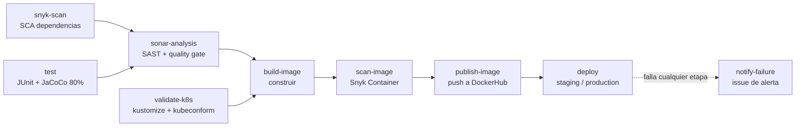

# Sanosysalvos - Geolocation Service

Microservicio de geolocalización de la plataforma Sanosysalvos (Spring Boot 4.1, Java 21, PostgreSQL, JWT).
Este repositorio incluye el **pipeline CI/CD completo en GitHub Actions**, contenerización, orquestación (Docker Compose y Kubernetes) y controles de calidad y seguridad (Evaluación Parcial 2, DOY0101 - Ingeniería DevOps).

## Tabla de contenidos

1. [Resumen y mapa de la rúbrica](#1-resumen-y-mapa-de-la-rúbrica)
2. [Quick start](#2-quick-start)
3. [Contenerización (Dockerfile multi-stage)](#3-contenerización-dockerfile-multi-stage)
4. [Pipeline CI/CD](#4-pipeline-cicd)
5. [Calidad: pruebas y cobertura](#5-calidad-pruebas-y-cobertura)
6. [Seguridad: análisis, bloqueos y alertas](#6-seguridad-análisis-bloqueos-y-alertas)
7. [Orquestación y escalabilidad](#7-orquestación-y-escalabilidad)
8. [Trazabilidad: del commit a producción](#8-trazabilidad-del-commit-a-producción)
9. [Configuración requerida en GitHub](#9-configuración-requerida-en-github)
10. [Estrategia de ramas (GitFlow)](#10-estrategia-de-ramas-gitflow)
11. [Equipo y uso de IA](#11-equipo-y-uso-de-ia)

---

## 1. Resumen y mapa de la rúbrica

| IE | Qué se pide | Dónde está implementado |
|---|---|---|
| **IE1** Contenedores | Dockerfile + build de imagen en el pipeline | [`Dockerfile`](Dockerfile) multi-stage (dependencias → test → compile → prod), usuario no-root, healthcheck, labels OCI; jobs `build-image`, `scan-image` y `publish-image` |
| **IE2** Pruebas automatizadas | Pruebas unitarias en el pipeline según políticas de calidad | 79 pruebas JUnit/Mockito/MockMvc, JaCoCo con **umbral mínimo de 80 %** que rompe el build; jobs `test` y etapa `test` del Dockerfile |
| **IE3** Seguridad y escalabilidad | Dependabot + Snyk/SonarQube; alertas o bloqueos | Dependabot ([`dependabot.yml`](.github/dependabot.yml)), Snyk (dependencias e imagen), SonarCloud con quality gate; todos **bloquean**; issue automático de alerta; límites de recursos y HPA |
| **IE4** Despliegue y trazabilidad | Despliegue automático en entorno simulado + README | Job `deploy` (Docker Compose, entornos `staging`/`production`), imagen etiquetada con el SHA del commit y verificada tras el despliegue |
| **IE5** Orquestación | Kubernetes o Docker Compose | [`docker-compose.yml`](docker-compose.yml) (réplicas + balanceador) **y** [`k8s/`](k8s) (Deployment, HPA, PDB, NetworkPolicy, StatefulSet) |

---

## 2. Quick start

Requisitos: Java 21, Maven 3.9+, Docker con Compose v2.

```bash
# Compilar, probar y verificar cobertura (mismo comando que usa el pipeline)
mvn clean verify

# Levantar todo el stack (gateway nginx + 2 réplicas + PostgreSQL)
docker compose up -d --build --wait

# Escalar a 4 réplicas sin tiempo de caída
APP_REPLICAS=4 docker compose up -d --no-build --wait

# Probar el despliegue (health, seguridad JWT, CRUD, GeoJSON)
bash scripts/smoke-test.sh http://localhost:8082

# Apagar y borrar datos
docker compose down -v
```

La configuración se parametriza con variables de entorno (ver [`.env.example`](.env.example)). Los valores por defecto son **solo para desarrollo**.

---

## 3. Contenerización (Dockerfile multi-stage)

```
dependencies ─> test ─> compile ─> prod
 (cache .m2)   (mvn test) (mvn package) (JRE alpine + JAR)
```

| Decisión | Motivo |
|---|---|
| Etapa `dependencies` separada | Las dependencias se cachean en una capa: si solo cambia el código, no se vuelven a descargar |
| Etapa `test` antes de `compile` | **Si una prueba falla, la imagen no se construye** (calidad también a nivel de imagen) |
| Imagen final `eclipse-temurin:21-jre-alpine` | Solo JRE + JAR: sin Maven, sin código fuente, superficie de ataque mínima |
| Usuario `10001:10001` (no-root) | Principio de mínimo privilegio; UID numérico para que Kubernetes pueda verificar `runAsNonRoot` |
| `HEALTHCHECK` sobre `/actuator/health` | Docker y Compose conocen el estado real de la app |
| `MaxRAMPercentage=75` | La JVM respeta el límite de memoria del contenedor |
| Labels OCI (`revision`, `created`, `version`) | Trazabilidad: toda imagen declara el commit que la originó |
| [`.dockerignore`](.dockerignore) | Contexto de build pequeño y sin secretos |

---

## 4. Pipeline CI/CD

Archivo: [`.github/workflows/ci-cd.yml`](.github/workflows/ci-cd.yml). Se ejecuta en `push` a `main` y `develop`, y en Pull Requests hacia ambas.



| # | Job | Qué hace | Bloquea si... |
|---|---|---|---|
| 1 | `snyk-scan` | Escaneo SCA de dependencias Maven | Hay vulnerabilidad de severidad **high** o superior |
| 2 | `test` | `mvn verify`: pruebas + reporte y regla JaCoCo | Falla una prueba o la cobertura de líneas es **< 80 %** |
| 3 | `sonar-analysis` | Análisis estático en SonarCloud y espera del quality gate (`sonar.qualitygate.wait`) en PRs y en `main`. En `develop` solo se sube el análisis, porque el plan gratuito no permite leer el gate de ramas no principales; ya se exigió en el PR | El quality gate de Sonar no se cumple |
| 4 | `validate-k8s` | Renderiza `k8s/` con kustomize y valida el esquema con kubeconform (modo estricto) | Un manifiesto es inválido |
| 5 | `build-image` | Construye la imagen (ejecuta las pruebas del Dockerfile) y la exporta como artefacto | Falla una prueba o el build |
| 6 | `scan-image` | Carga esa misma imagen y la escanea con Snyk Container | Vulnerabilidad **critical** en la imagen |
| 7 | `publish-image` | Etiqueta y publica en DockerHub **la imagen ya escaneada** (solo en `push`) | Falla el login o el push |
| 8 | `deploy` | Despliega con Docker Compose en el runner, verifica trazabilidad, smoke test y escalado | Cualquier verificación falla |
| 9 | `notify-failure` | Abre un issue con el commit, el enlace a la ejecución y los jobs fallidos | (Se ejecuta solo si algo falló en un `push`) |

Detalles de diseño:

- **Construir, escanear y publicar son jobs separados y consecutivos:** la imagen viaja como artefacto entre ellos, de modo que lo que se escanea es byte a byte lo que se publica. Cada etapa tiene su propio estado y log.
- **Gates encadenados con `needs`:** una etapa solo corre si las anteriores pasaron; la publicación de la imagen y el despliegue quedan protegidos por todos los controles.
- **Paralelismo:** `snyk-scan`, `test` y `validate-k8s` corren en paralelo para acortar el tiempo total.
- **Cachés:** dependencias Maven (`setup-java`), caché de Sonar y caché de capas Docker (`type=gha`).
- **Permisos mínimos:** el workflow parte con `contents: read`; solo `notify-failure` recibe `issues: write`.
- **`concurrency`:** en PRs se cancela la ejecución anterior; en `main`/`develop` nunca se cancela un despliegue en curso.
- **Artefactos:** `snyk-report`, `snyk-container-report`, `jacoco-report` y `surefire-reports` quedan adjuntos a cada ejecución.

---

## 5. Calidad: pruebas y cobertura

**Política de calidad:** la cobertura de líneas debe ser **>= 80 %**; el umbral está en el `pom.xml` (`jacoco.minimum.coverage`) y la regla `jacoco:check` rompe `mvn verify` si no se cumple. Cobertura actual: **~98 %** (79 pruebas).

| Capa | Pruebas | Casos críticos cubiertos |
|---|---|---|
| Servicios (`CoordenadaService`, `ComunaService`, `RegionService`, `MapaDeCalorService`) | JUnit 5 + Mockito | Éxito, recurso inexistente (404), integridad referencial (comuna/región inexistente), `delete` sin borrar si no existe, fallo SQL tolerado al actualizar el reporte |
| Seguridad (`JwtFilter`) | Unitarias | Sin header, token válido, expirado, firmado con otra clave, malformado |
| Controladores (REST + seguridad real) | `@WebMvcTest` + MockMvc | Sin token → 403, token inválido → 401, validación de entrada → 400 con detalle por campo, 201/204, GeoJSON con orden `[lon, lat]`, decodificación de geohash |

Reportes: HTML/XML/CSV en `target/site/jacoco/` (artefacto `jacoco-report` en cada ejecución). `lombok.config` marca el código generado por Lombok para que no infle ni distorsione la cobertura.

---

## 6. Seguridad: análisis, bloqueos y alertas

| Capa | Herramienta | Momento | Acción ante fallo |
|---|---|---|---|
| Dependencias (SCA, continuo) | **Dependabot** (Maven, Docker, GitHub Actions; semanal) | Fuera del pipeline | Abre PRs automáticos con parches |
| Dependencias (SCA, en cada cambio) | **Snyk** `--severity-threshold=high` | Job 1 | **Bloquea** el pipeline |
| Código fuente (SAST) | **SonarCloud** + quality gate | Job 3 | **Bloquea** el pipeline |
| Imagen y sistema base | **Snyk Container** `--severity-threshold=critical` | Job `scan-image`, antes de publicar | **Bloquea** la publicación |
| Manifiestos K8s | kubeconform `-strict` | Job 4 | **Bloquea** el pipeline |
| Secretos | GitHub Secrets; credenciales efímeras en el despliegue | Job 6 | n/a |

**Bloqueos:** además de los gates del pipeline, se recomienda activar *branch protection* (ver [sección 9](#9-configuración-requerida-en-github)) para que ningún PR se pueda mezclar en `main` con checks en rojo.

**Alertas:** cuando un `push` a `main` o `develop` falla, el job `notify-failure` abre automáticamente un **issue** que lista el commit, los jobs fallidos y el enlace a la ejecución. GitHub además notifica por correo a los participantes del repositorio.

**Gestión de vulnerabilidades (caso real de este proyecto):** la primera ejecución de Snyk bloqueó el pipeline con 33 hallazgos (7 críticos, 26 altos) en Spring Boot 3.5.16 (Tomcat, Spring Framework, Spring Security, Jackson, Micrometer). La línea 3.5 ya no recibe correcciones (`spring-framework` 6.2.19 es la última 6.2), por lo que la remediación fue **migrar a Spring Boot 4.1.2** en lugar de silenciar alertas. Además se reemplazó `jjwt-jackson` por `jjwt-gson`, lo que elimina del classpath Jackson 2 (9 avisos propios). Tras la migración Snyk bajó de 33 a 2 hallazgos, que se trataron así:

| Hallazgo | Tratamiento |
|---|---|
| Jackson 3 `databind` 3.1.7, deserialización insegura (**crítico**, vía Flyway) | **Corregido:** se fija `jackson-bom.version` en 3.1.8 en el `pom.xml` |
| `jaxb-core` 4.0.9, XXE (**alto**, vía Hibernate) | **Excepción documentada** en [`.snyk`](.snyk): no existe versión corregida (4.0.9 es la última) y no es alcanzable, porque la API solo procesa JSON y JAXB únicamente lee mapeos propios de Hibernate. **Vence el 2027-01-31** y debe revisarse; Dependabot propondrá la actualización en cuanto se publique un parche |

La política `.snyk` solo permite excepciones con razón y vencimiento, y el umbral `high` del pipeline sigue bloqueando cualquier otro hallazgo.

**Gobernanza adicional:**
- Si falta un token de seguridad, el job **falla explícitamente** (nunca se omite el análisis en silencio).
- El despliegue genera `JWT_SECRET` y la contraseña de BD **aleatorios por ejecución** y los enmascara en los logs.
- Contenedores sin privilegios: `cap_drop: ALL`, `no-new-privileges`, sistema de archivos de solo lectura (`read_only` + `tmpfs /tmp`), BD sin puertos publicados.

---

## 7. Orquestación y escalabilidad

### Docker Compose ([`docker-compose.yml`](docker-compose.yml))

```
cliente ─> gateway (nginx, :8082) ─> geolocation-service (N réplicas) ─> postgres
```

- **Healthchecks encadenados** con `depends_on: condition: service_healthy`: Postgres → app → gateway. Nada arranca antes de que su dependencia esté realmente lista.
- **Escalado horizontal:** `APP_REPLICAS` / `--scale`; el gateway reparte las peticiones entre réplicas con el DNS interno de Docker (round-robin), sin reiniciarse al escalar.
- **Límites de recursos** (`deploy.resources`): app 1 CPU / 768 MB (reserva 0,5 CPU / 384 MB), Postgres 0,5 CPU / 512 MB, gateway 0,25 CPU / 128 MB.
- Red interna aislada; solo el gateway publica un puerto.

### Kubernetes ([`k8s/`](k8s))

Se aplica con `kubectl apply -k k8s` (requiere un clúster; el pipeline solo **valida** los manifiestos).

| Recurso | Configuración relevante |
|---|---|
| `Deployment` | 2 réplicas, `RollingUpdate` con `maxUnavailable: 0` (sin caída), `topologySpreadConstraints`, probes `startup`/`readiness`/`liveness`, requests/limits, `runAsNonRoot`, `readOnlyRootFilesystem`, `drop ALL`, seccomp `RuntimeDefault` |
| `HorizontalPodAutoscaler` | Entre 2 y 6 réplicas por CPU 70 % y memoria 80 %; reduce con ventana de 5 min para evitar *flapping* |
| `PodDisruptionBudget` | `minAvailable: 1` durante mantenciones de nodos |
| `StatefulSet` PostgreSQL | Volumen persistente de 1 Gi, probes con `pg_isready` |
| `NetworkPolicy` | Postgres solo acepta tráfico de los pods de la aplicación |
| `Namespace` | Pod Security Standard `restricted` |
| `ConfigMap` / `Secret` | Configuración separada de la imagen; el Secret del repo es solo para demo (ver comentario en `kustomization.yaml`) |

---

## 8. Trazabilidad: del commit a producción

Cada artefacto lleva el identificador del commit que lo originó:

```
commit (SHA completo)
  └─> imagen DockerHub  tag: sha-<7 caracteres>  + label OCI org.opencontainers.image.revision = SHA completo
        └─> digest inmutable registrado en el resumen del despliegue
              └─> despliegue en el entorno (staging | production) con APP_IMAGE = ese tag
                    └─> verificación automática: el label de cada contenedor en ejecución == SHA del commit
```

- **Entornos de GitHub:** `develop` → `staging`, `main` → `production`. La pestaña *Environments / Deployments* del repositorio muestra el historial de qué commit se desplegó, cuándo y quién lo originó.
- **No se despliega `latest`:** el despliegue usa el tag inmutable por SHA; `latest` solo se publica desde `main`.
- **Verificación post-despliegue:** el job `deploy` falla si la imagen en ejecución no corresponde al commit.
- **Resumen por ejecución:** el job escribe commit, imagen, digest y enlace a la ejecución en el *Job summary*.
- **Cobertura y hallazgos de seguridad** quedan asociados a la misma ejecución como artefactos.

---

## 9. Configuración requerida en GitHub

**Settings → Secrets and variables → Actions → Secrets:**

| Secreto | Descripción |
|---|---|
| `SYNK` | Token de Snyk (app.snyk.io → Account settings → Auth Token) |
| `TOKENINGDEVOPS` | Token de SonarCloud (sonarcloud.io → My Account → Security) |
| `DOCKERHUB_USERNAME` | Usuario de DockerHub |
| `DOCKERHUB_TOKEN` | Access token de DockerHub |
| `DOCKERHUB_REPONAME` | Nombre del repositorio de la imagen en DockerHub |

**Variables (opcionales):** `SONAR_ORGANIZATION` y `SONAR_PROJECT_KEY`. Por defecto se usan `<owner>` y `<owner>_<repo>` en minúsculas (como los genera SonarCloud); definirlas solo si el proyecto en SonarCloud tiene otros valores.

**Branch protection (recomendado):** *Settings → Branches → Add rule* para `main` y `develop`: exigir Pull Request y que pasen los checks `Snyk - dependencias (SCA)`, `Pruebas unitarias y cobertura (JaCoCo)` y `SonarCloud - calidad y seguridad (SAST)`.

**Dependabot:** se activa solo al existir [`dependabot.yml`](.github/dependabot.yml); apuntar a la rama `develop`.

---

## 10. Estrategia de ramas (GitFlow)

- **`main`**: producción; solo versiones estables. Despliega a `production`.
- **`develop`**: integración; despliega a `staging`.
- **`feature/*`**, **`bugfix/*`**: desarrollo desde `develop`, se integran por Pull Request.
- **`release/*`** y **`hotfix/*`**: preparación de versiones y parches críticos desde `main`.

Convención de commits (Conventional Commits): `feat:`, `fix:`, `docs:`, `refactor:`, `test:`, `chore:`. Versionado semántico (MAJOR.MINOR.PATCH).

```
src/main/java/org/sanosysalvos/{controller,service,repository,entity,dto,security,exception}
src/test/java/org/sanosysalvos/...
k8s/        manifiestos Kubernetes (kustomize)
deploy/     configuración del gateway nginx
scripts/    smoke-test.sh
.github/    workflows/ci-cd.yml y dependabot.yml
```

---

## 11. Equipo y uso de IA

- **Desarrollador:** Rodrigo Baeza
- **Curso:** DOY0101 - Ingeniería DevOps, DUOC UC

### Uso de Inteligencia Artificial

Se utilizó Claude (Anthropic) como apoyo para: diseño y depuración del pipeline de GitHub Actions, redacción de pruebas unitarias, configuración de Docker Compose y manifiestos de Kubernetes, y redacción y estructuración de esta documentación. Las configuraciones fueron revisadas, y los artefactos se verificaron ejecutando localmente las pruebas, la construcción de la imagen y el despliegue con Compose.
